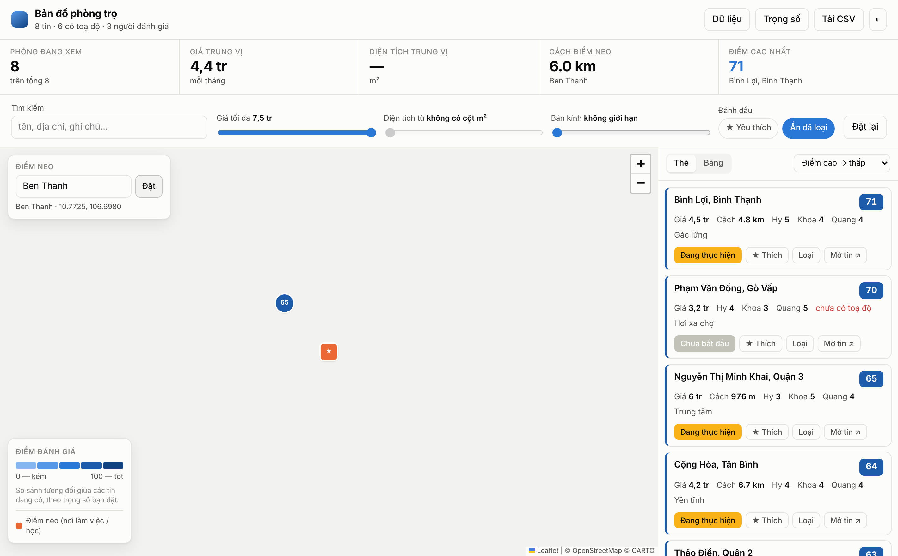

# Bản đồ phòng trọ

Giao diện trực quan để **so sánh và chấm điểm các phòng trọ trên bản đồ**, dựng từ
bảng theo dõi `BDS` (Google Sheets).

Một trang tĩnh, không backend. Toàn bộ dữ liệu và đánh dấu nằm trong `localStorage`
của trình duyệt — không gửi đi đâu.



Bản dùng online: **https://quangdang2001.github.io/bds-location/**

## Chạy

```bash
python3 -m http.server 8000
```

Rồi mở http://localhost:8000 . Mở thẳng `index.html` bằng `file://` cũng được
(dữ liệu đã nhúng sẵn trong `data/dataset.js`).

Trang cần mạng cho **nền bản đồ** (CARTO/OpenStreetMap) và **tra toạ độ**
(Nominatim). Thư viện Leaflet / PapaParse / SheetJS đã để sẵn trong `vendor/`
nên không phụ thuộc CDN.

## Cách dùng

| | |
|---|---|
| **Điểm neo** | Nhập địa chỉ nơi làm việc / học, hoặc bấm thẳng lên bản đồ. Mọi khoảng cách tính từ đây; có thể kéo ghim ★ để đổi. |
| **Trọng số** | Bạn coi trọng giá, khoảng cách hay điểm của từng người bao nhiêu. Điểm 0–100 tính lại ngay. |
| **Bộ lọc** | Giá tối đa, diện tích tối thiểu, bán kính quanh điểm neo, từ khoá, chỉ xem ★, ẩn tin đã loại. |
| **★ / Loại** | Đánh dấu từng tin, lưu lại giữa các lần mở. |
| **Tải CSV** | Xuất đúng những tin đang hiển thị, kèm cột điểm, khoảng cách và toạ độ. |

Thẻ, hàng trong bảng và ghim trên bản đồ được đồng bộ: rê chuột ở đâu cũng làm
nổi bật ở nơi kia.

## Cách tính điểm

Mỗi tiêu chí được chuẩn hoá min–max trên **chính danh sách đang có** rồi cộng theo
trọng số, nên điểm là **so sánh tương đối giữa các tin**, không phải thước đo tuyệt đối.
Tiêu chí thiếu dữ liệu được tính trung tính (0,5); tin không có dữ liệu cho bất kỳ
tiêu chí nào hiện `—` thay vì một con số giả.

Trong các cột đánh giá, **ô trống hoặc `0` nghĩa là “chưa đánh giá”**, không phải
điểm 0 — khớp với giá trị mặc định của bảng gốc.

## Cập nhật dữ liệu

Ba cách, không cách nào cần sửa code:

1. **Dán** — bôi đen vùng dữ liệu kèm dòng tiêu đề trong Google Sheets, Ctrl‑C,
   dán vào *Dữ liệu → mục 1*.
2. **Tải file** — kéo file `.xlsx` vào *Dữ liệu → mục 2*.
3. **Link** — *Tệp → Chia sẻ → Xuất bản lên web → CSV* trong Sheets, dán link vào
   *Dữ liệu → mục 3*. Link `/htmlview` hay `/edit` **không dùng được** (trình duyệt chặn CORS).

> **Xuất CSV làm mất hyperlink.** Cột `Location` trong bảng gốc là *chữ* “Binh Loi”
> kèm *liên kết* tới Google Maps; bản CSV chỉ còn chữ. Vì vậy hãy dùng **`.xlsx`**
> khi muốn giữ liên kết bản đồ — trang đọc được hyperlink của từng ô và coi chúng
> là cột `"<Tên cột> (link)"`.

Để đổi dữ liệu mặc định lúc mở trang:

```bash
cp bảng-mới.xlsx data/BDS.xlsx
python3 tools/embed.py
python3 tools/build.py
```

## Số điện thoại

Repo này **public**, và `data/dataset.js` được nhúng thẳng vào trang web, nên
`tools/embed.py` **che số điện thoại theo mặc định**: `038 548 6855` → `038 •••• 55`.
Cần bản đầy đủ để dùng ở máy mình:

```bash
python3 tools/embed.py --keep-contacts   # ĐỪNG commit kết quả
```

`data/*.xlsx` nằm trong `.gitignore` vì bảng gốc chứa số chưa che — giữ file đó
ở Drive hoặc máy bạn, đừng đẩy lên.

> Số điện thoại cũ vẫn còn trong **lịch sử git** (các commit trước `e810d12`).
> Nếu cần xoá hẳn thì phải viết lại lịch sử và force-push.

## Tìm toạ độ

Theo thứ tự:

1. Cột `lat` / `lng`, nếu có.
2. Toạ độ nhúng trong link Google Maps (`!3d…!4d…`, `@10.8,106.7`, `?q=…`).
3. Tên địa điểm lấy từ link (`/maps/place/Binh+Loi/…`) hoặc chữ trong ô địa chỉ,
   tra qua **Nominatim** (1 yêu cầu/giây, kết quả lưu lại).

Link Google Maps dạng chỉ có mã địa điểm (`…!19sChIJ…`) **không chứa toạ độ**;
trang lấy tên trong link rồi tra như bước 3. Nếu ra sai chỗ, sửa ô “Thành phố”
trong *Dữ liệu → Gán cột*, hoặc thêm hẳn cột `lat`/`lng` vào bảng.

## Gán cột

Cột được nhận tự động theo tên tiếng Việt (có dấu hay không đều được): *Giá,
Location, Trạng thái, Contact, Ngày đến hạn, Ghi chú,* và mọi cột tên dạng
`<Tên người> - Review` thành một tiêu chí chấm điểm riêng. Sai thì sửa trong
*Dữ liệu → Gán cột*; lựa chọn được ghi nhớ.

## Build & hosting

`tools/build.py` nhét CSS, JS, thư viện và dữ liệu vào **một file HTML ~253 KB**,
không phụ thuộc file nào khác — mở bằng `file://`, gửi qua chat hay upload đâu cũng chạy:

```bash
python3 tools/build.py
```

GitHub Actions (`.github/workflows/pages.yml`) chạy đúng lệnh đó ở mỗi lần push rồi
deploy lên GitHub Pages, nên bản online không bao giờ cũ hơn mã nguồn.

Ngoại lệ duy nhất không gộp vào: **SheetJS (~880 KB)**, chỉ dùng khi tải file `.xlsx`
trong trình duyệt — nạp từ CDN lúc cần nên trang thường ngày vẫn nhẹ.

## Cấu trúc

```
index.html          khung giao diện (bản nhiều file, để phát triển)
assets/style.css    bảng màu sáng/tối, bố cục
assets/app.js       nạp dữ liệu, chấm điểm, bản đồ, lọc
data/BDS.xlsx       bảng gốc
data/dataset.js     dữ liệu nhúng, sinh từ BDS.xlsx
tools/embed.py      BDS.xlsx  →  dataset.js (giữ hyperlink)
tools/build.py      tất cả     →  docs/index.html (một file)
docs/index.html     BẢN BUILD — sinh tự động, đừng sửa tay
vendor/             Leaflet, PapaParse, SheetJS
```

## Màu

Thang điểm dùng một dải xanh đơn sắc nhạt→đậm (0→100), chọn riêng cho nền sáng và
nền tối, đã kiểm bằng validator: đơn sắc, độ sáng tăng đều, đầu nhạt vẫn tách khỏi
nền. Con số luôn in trong ghim và trên thẻ, nên không phụ thuộc vào màu để đọc.
